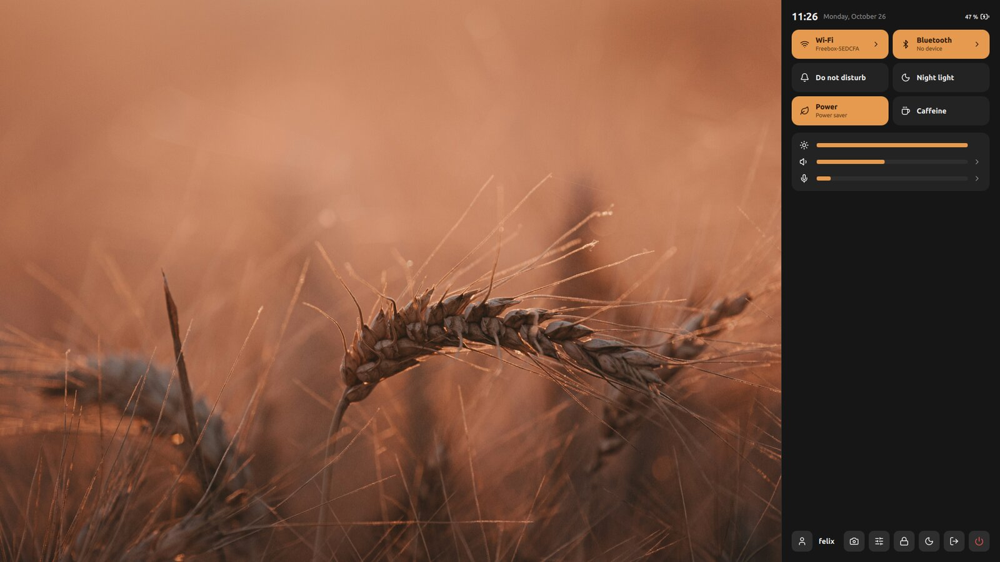
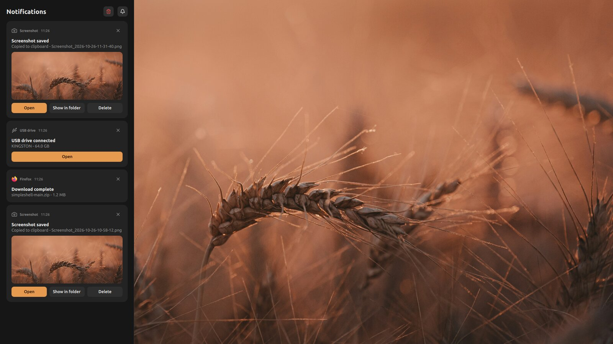
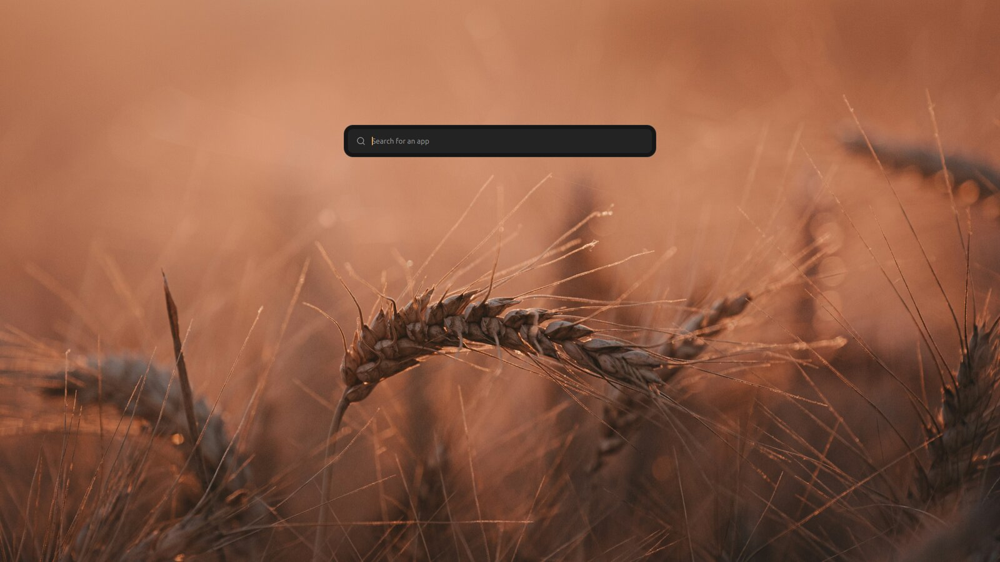
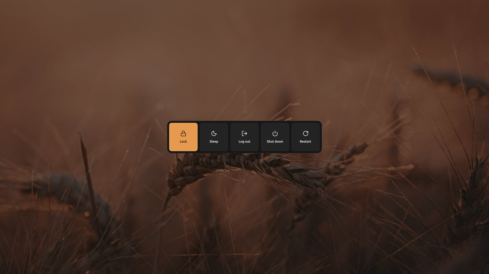
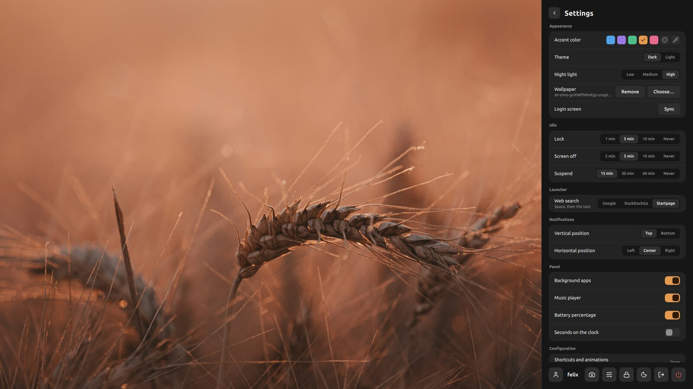
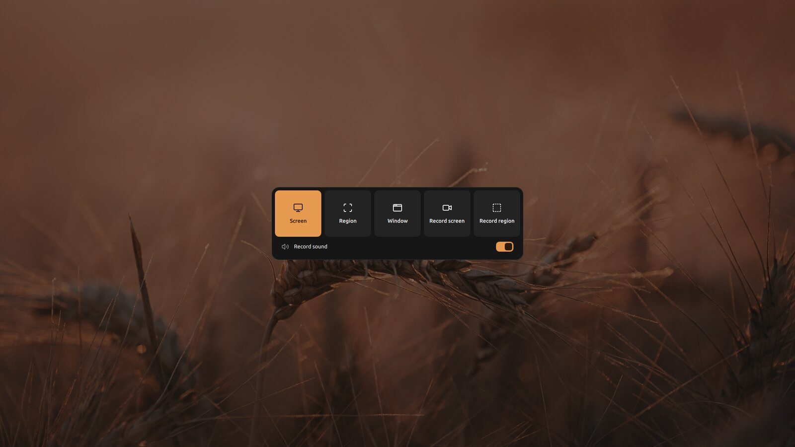
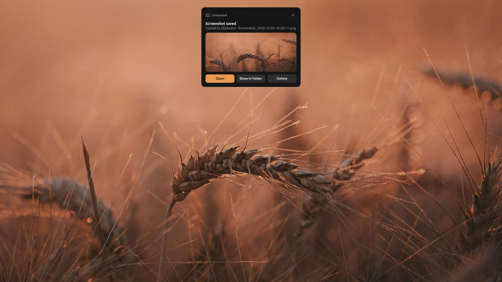

# SimpleShell

[Version française](README_FR.md)

**A shell for Hyprland, without a bar: nothing on screen, everything within reach.**

Your desktop stays empty. The quick panel, notifications, launcher or screenshots appear with a
shortcut or a swipe on the touchpad, then fade away. Built with
[Quickshell](https://quickshell.org), for Arch Linux.



<details>
<summary><b>Watch the video</b></summary>
<br>


[MP4 version](docs/showcase.mp4)

</details>

## What's inside

<table>
<tr>
<td></td>
<td><b>Quick panel</b> <code>Super + A</code><br>Time, battery, Wi-Fi, Bluetooth, Do not disturb, night light, power profile, caffeine, brightness, sound, microphone, now playing, background apps.</td>
</tr>
<tr>
<td></td>
<td><b>Notifications</b> <code>Super + N</code><br>History, image previews, action buttons, Do not disturb.</td>
</tr>
<tr>
<td></td>
<td><b>Launcher</b> <code>Super + Space</code><br>Type an app's name. Start with a space to search the web.</td>
</tr>
<tr>
<td></td>
<td><b>Power menu</b> <code>Super + Escape</code><br>Lock, sleep, log out, shut down, restart.</td>
</tr>
<tr>
<td></td>
<td><b>Settings</b> (panel button)<br>Accent color, light or dark theme, wallpaper, idle delays, notification position…</td>
</tr>
</table>

And also:

- **Discreet bubbles (OSD)** for volume, brightness, keyboard, microphone, airplane mode…
- **Reminders**: low battery, USB drive plugged in.
- **The administrator password prompt** (polkit), in the shell's colors.
- **Matching lock and login screens.** *Lock* locks with hyprlock; *Sleep* and suspend go
  through the login screen (SDDM), which reopens your session.
- **Your apps in the same colors**: GTK, Qt, KDE, Alacritty, mpv, micro, imv, and the window
  borders. Change the color, everything follows.

## Screenshots and recordings



Press `Print` (or `Super + Shift + S`).

- **Screen**, **Region**, **Window**: the whole screen, an area to draw, or a window to click.
- **Record screen**, **Record region**: records the screen as a video. To stop, press `Print`
  again.
- Pressed twice in a row, `Print` captures the whole screen right away.

The capture is copied to the clipboard and saved in `Pictures/Screenshots` (or
`Videos/Recordings`).



## Shortcuts

| Keys | Action |
|---|---|
| `Super + A` | quick panel |
| `Super + N` | notifications |
| `Super + Space` | launcher |
| `Super + Escape` | power menu |
| `Print` or `Super + Shift + S` | screenshot |
| `Shift + Print` | screenshot of an area, right away |
| `Super + P` | screen layout (Monique) |
| 4 fingers ← / → (touchpad) | quick panel / notifications |

The volume, brightness, media and keyboard backlight keys work too, with their bubble on screen.

<details>
<summary>From a terminal or a script</summary>

```sh
qs -c simpleshell ipc call shell panel             # or notifications, launcher, power, capture
qs -c simpleshell ipc call shell page settings     # or wifi, bluetooth
qs -c simpleshell ipc call shell dnd               # Do not disturb
qs -c simpleshell ipc call shell screenshot region # or screen, window
qs -c simpleshell ipc call shell record screen     # or region; stopRecording to stop
```

</details>

## Installation

You need **Arch Linux** (or CachyOS, EndeavourOS…) and **Hyprland 0.56 or newer**, with a Lua
config (`hyprland.lua`).

```sh
git clone https://github.com/git-psi/simpleshell ~/.config/quickshell/simpleshell
~/.config/quickshell/simpleshell/install.sh
```

Then log out and pick Hyprland on the login screen. That's it!

The installer installs what's needed, enables the services, and adds the shell to your Hyprland
config without replacing it.

<details>
<summary>What the script does</summary>

- **Packages** from the official repositories: Quickshell, the Hyprland tools, PipeWire,
  NetworkManager, Bluetooth, power management, the capture tools, the fonts. And a few default
  apps: Alacritty (with fish), Nautilus, imv, mpv, micro.
- **AUR**, only for Monique (screens) and the Bibata cursor, through paru, yay or makepkg.
- **Hyprland**: adds `require("simpleshell")` at the end of your `hyprland.lua`, or creates a
  minimal one if you don't have one.
- **Services**: NetworkManager, Bluetooth, power profiles, and SDDM for the login screen. If it
  finds another login manager, it asks before replacing it.
- The files it replaces are kept next to them, as `*.bak-<date>`.

</details>

> **Don't run at the same time**: SimpleShell handles notifications and password prompts itself.
> Disable mako, dunst, swaync, hyprpolkitagent or polkit-gnome, and any other bar (Waybar…).

## Configuration

**The easiest: the Settings page** of the quick panel. Accent color, theme, wallpaper, idle
delays, search engine, notification position, what the panel shows. After changing the accent or
the wallpaper, click **Sync** on the *Login screen* row so the login screen follows.

To go further, everything can be edited by hand:

| File | What it holds |
|---|---|
| `hypr/simpleshell.lua` | the shell's shortcuts, window animations, the cursor |
| `hypr/hyprlock.conf` | the lock screen |
| `Theme.qml` | all the style: colors, font, sizes, radii, durations |
| `Config.qml` | the commands (lock, sleep…) and the search engines |

The shell reloads on its own when you save a `.qml` file. For `simpleshell.lua`, run
`hyprctl reload`. `hyprlock.conf` is read again at the next lock.

The rest of Hyprland (keyboard, windows, workspaces) stays in your own config.
You can see mine here: [HYPRLAND.md](HYPRLAND.md).

## Development

```sh
pkill -x qs; qs -c simpleshell      # runs the shell in the terminal, with its debug messages
```

Every saved file reloads the shell. To run it in the background again: `qs -c simpleshell -d`.

<details>
<summary>Code layout</summary>

```
shell.qml        entry point
Theme.qml        all the style
Ui.qml           what is open
Settings.qml     the Settings page values
components/      reusable building blocks (buttons, tiles, Lucide icons…)
services/        network, Bluetooth, sound, brightness, power, notifications, captures
panel/           the quick panel and its pages
notifs/          notifications
launcher/        launcher
capture/         screenshots and recordings
osd/             on-screen bubbles
power/           power menu, idle, battery
polkit/          administrator password
apps/            app colors (matugen)
sddm/            login screen
hypr/            Hyprland, hypridle and hyprlock config
```

</details>

The style rules followed during development:

- Every color, size or duration comes from `Theme.qml`, never written anywhere else.
- Rounded corners everywhere, no circles or pills (inner radius = outer radius − gap between
  the two).
- No shadows: whatever floats has a one-pixel outline.
- [Lucide](https://lucide.dev) icons: copy the SVG into `components/lucide/`, then
  `Icon { name: "wifi" }`.

## License

MIT (`LICENSE`). [Lucide](https://lucide.dev) icons under the ISC license (`LICENSE-lucide`).

---

<p align="center">
Made with ❤️ · designed by <a href="https://github.com/git-psi">git-psi</a>, developed with
<a href="https://claude.com/claude-code">Claude</a>
</p>
